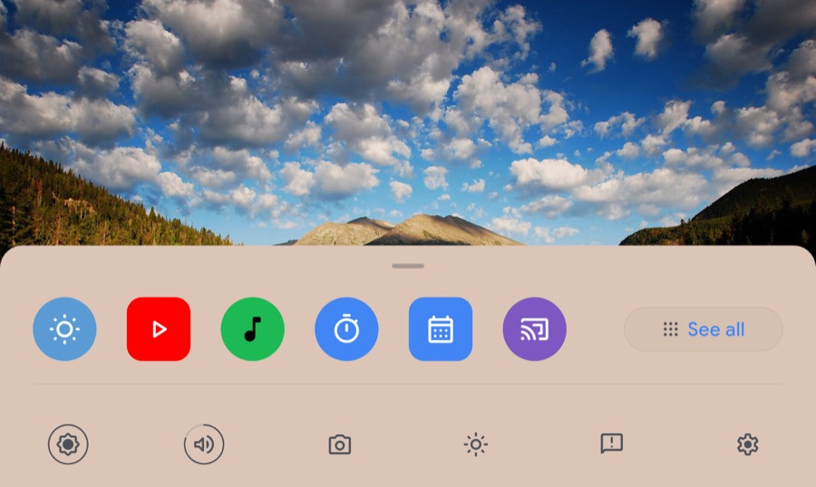
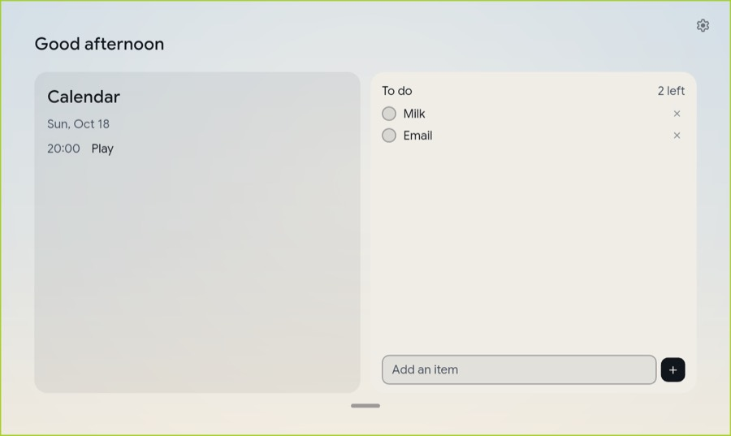
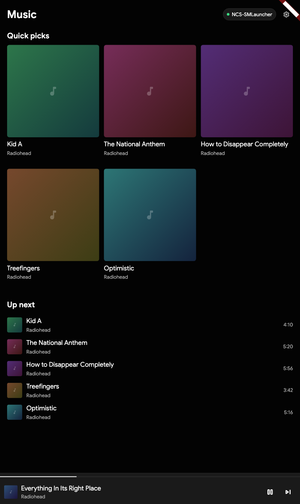
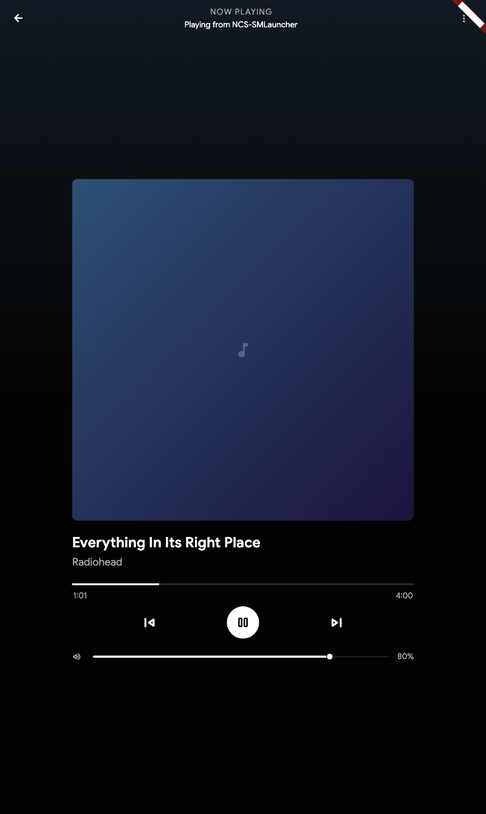

# SN-Launcher

**v0.1.3** · [Download](#download) · [INFO.md](INFO.md) for the technical record

A Google Nest Hub style launcher for **Android**, for putting an old tablet on
a wall and having it look like a smart display.

<p align="center">
  
  
</p>
<p align="center">
  
</p>

---

## Download

Grab it from **[releases](../../releases/latest)**.

| File | Size | For |
|---|---|---|
| **`SN-Launcher-0.1.2.apk`** | 32 MB | **Start here.** Works on any phone or tablet from roughly 2014 on. |
| `SN-Launcher-0.1.2-arm64.apk` | 18 MB | Smaller. Nearly all modern tablets. |
| `SN-Launcher-0.1.2-armv7.apk` | 16 MB | Smaller. Older budget tablets. |
| `SN-Launcher-0.1.2-x86_64.apk` | 20 MB | Chromebooks, emulators. |
| `SN-Launcher-0.1.2-beta-arm64.apk` | 18 MB | The beta. Everything on. |

Copy the `.apk` to the device and tap it, allowing **Install unknown apps** for
whatever opened it. Or over USB:

```bash
adb install -r SN-Launcher-0.1.2.apk
```

Then set it as your home screen.

### Two things to know first

**It is signed with a debug key.** Android allows sideloading a debug-signed
APK, so it installs fine — but there is no release keystore in the repository,
and the key that signed this file lives on one machine. If a later build is
signed with a different key, Android refuses to install over the top and you
have to uninstall first, losing your settings. **Expect to reinstall rather
than upgrade.**

**It wants to be the home screen.** Set it as default launcher after
installing.

---

## What you get

**The shipping build** is a launcher: the Nest-style clock and photo, the app
row and the full app grid, brightness and volume, and a settings page.

Page two holds the two things worth glancing at: a **calendar** that shows the
date and what's on today, and a **to-do list** you can add to, tick off and
delete. The to-do list is saved on the device, so it is still there tomorrow.

**The beta** additionally has the voice assistant, a music player, rotating
photographs, live weather, and the "Sun" theme that follows the time of day. It
is a *separate app* with its own icon, so you can install both and compare.

 

The beta's music page is a **remote control for
[NCS-SMLauncher](https://github.com/SimpleAppLauncher/NCS-SMLauncher)**, the
other project: the player does the playing, the tablet draws the library and
sends the button presses. So the music keeps playing when the launcher
restarts, and a 1 GB tablet does not have to hold a library. A mock player is
included, so the page can be tried before the real one is ready — see
[`docs/NCS.md`](docs/NCS.md).

As of this build the page is verified against that mock on hardware; the real
NCS-SMLauncher does not speak this protocol yet, so the page does not claim it
is controlling the real player. The chip names whichever server answered, and
the mock's name says "(mock)".

**The Home control page is compiled but disabled in both builds.** Both
`assets/features.ef.json` and `assets/features.json` set
`"homeControl": false`. The page, its code and its tests stay in the tree, but
it is not in either carousel: the beta is home → digest → weather → music, and
the shipping build is home → digest. This is the tile page, not the clock/photo
home; the main home screen is unchanged. It was disabled because there were no
real device controls behind its tiles, and the rule here is that the UI does not
claim a capability it does not have. Flip the flag, do not delete the page,
when the tiles are real.

What is in each build is decided by a JSON file, not by code — see
[`docs/BUILDS.md`](docs/BUILDS.md).

---

## What actually works

Run on real hardware: a **Samsung Galaxy Tab A7 Lite** (Android 15, MediaTek
MT6789, 800x1340) and a **Nokia T20** (Android 13, Unisoc T610, 2000x1200).

| | |
| --- | --- |
| The clock, date and weather | ✓ |
| The photo frame, rotating every 10 min | ✓ |
| The app row and the six-column grid | ✓ |
| A calendar reading real events, with the date | ✓ |
| A to-do list you can add to, tick off and delete | ✓ |
| The quick-settings row — every button does something | ✓ |
| Five themes | ✓ |
| Settings | ✓ |
| Cold start | **548 ms** on the Tab A7 Lite release; **509–603 ms** on the T20 release after the first install |

**Not yet verified end to end: the voice assistant and the real NCS-SMLauncher.**
The assistant has never heard a microphone. The ef music page has now been
swiped to on both tablets, and it connected to the mock over the LAN on the
SM-X110 profile, the SM-X110 ef release and the T20 ef release. Pause/next were
read back from the mock on the T20 and the profile. The real player is still the
mock's contract only. The old WebView music panel lived on the now-disabled Home
control page.

The ef's first launch straight after installing is 3.3 s (the reduced's is
1.2 s) while Android extracts the package; every cold start after that is
~0.5–0.6 s. That one-time cost is the installer's, not a startup path in the
app.

### Measured performance

Release builds unless marked "profile". The profile numbers come from the
SM-X110 with `PERF_OVERLAY=true`; the T20 release CPU numbers are from `top`,
and PSS/cold start are from `dumpsys meminfo` and `am start -W`. The release
builds ship without the overlay.

| | |
| --- | --- |
| Home idle | 2.6% CPU (T20 ef release), 3.0% (SM-X110 profile) |
| Digest idle | 2.3% (T20 ef release), 0.3% (T20 reduced release, at rest) |
| Weather | 3.3% (T20 release, no place photo); 1.1% static vs **91.6%** with the 60 fps glyph (SM-X110 profile) |
| Music | 2.6% (T20 release, mock playing); 4.8% vs 10% before the timer/cache work (SM-X110 profile) |
| Cold start | 548 ms (SM-X110 release); 509–603 ms (T20 release, after the first install) |
| PSS | 102 MB ef / 81 MB reduced (T20); 140 MB ef (SM-X110) |

The weather glyph is **static** on the shipped page. The animation code remains
in `weather_glyph.dart`; the 60 fps version cost 91.6% CPU on the SM-X110 and the
static page costs 1.1%. This is a deliberate trade for 1–4 GB tablets, not a
capability that was removed and then claimed.

---

## Known rough edges

- **Held in portrait on a portrait-native tablet the layout looks small.** The
  manifest pins `sensorLandscape`, so turn the tablet sideways.
- **The quick-settings row has seven buttons and the spacing is measured
  against a photograph of a real Nest Hub Max — but two of the seven are not
  the same controls the real device shows.**
- **"Pixel-accurate" was an overstatement.** Measured against a reference
  photograph: the clock block and the badge pitch. Eyeballed: everything else.
  The full accounting is in [INFO.md](INFO.md) §1.
- **The navigation is a page carousel; the real device uses layers.** Also in
  INFO.md §1.
- **The weather glyph is static by choice.** The 60 fps glyph cost 91.6% CPU on
  the SM-X110; the static page costs 1.1%. The animation code remains, but the
  shipped page does not run it. This is a deliberate trade for 1–4 GB tablets,
  not a removed capability.

---

## Credits

Written by **Giathinh1234**, and built with **[OpenCode](https://opencode.ai)** —
not Claude Code, and no part of it came from Anthropic. There is no
`Co-Authored-By: Claude` trailer anywhere in the history, and GitHub's
contributor list for this repository contains exactly one account. The
OpenCode references in [`docs/MODELS.md`](docs/MODELS.md) and
[`tool/chatlog.py`](tool/chatlog.py) are deliberate, so the tool is
unambiguous without anyone having to guess.

Built in Flutter — the same stack Google used for the real Nest Hub, which is
what makes matching it realistic at all.

* **Google Sans** (SIL OFL 1.1), bundled genuinely rather than approximated.
  This is the single biggest reason the clock reads as "Google".
* **Material Symbols** (Apache 2.0), subsetted to the 172 glyphs in use.
* **Poppins** (SIL OFL 1.1) for the thinner "Timeless Light" clock face.
* The bundled photograph — *Cub Lake at dawn* by **Debra Miller** — is public
  domain, and her name is rendered on screen because the licence asks for it.
  The rotating pool is public domain, CC0 or plain CC-BY only.
* Brand marks (Spotify, Netflix, Pandora, YouTube) are drawn as paths.

---

## Build it yourself

```bash
flutter build apk --release --target-platform android-arm,android-arm64
```

### Linux and macOS

Both versions build for desktop too. The same Dart, the same two feature
JSON files.

Neither can be built from a Mac: **Linux cannot be cross-compiled at all**,
and **macOS needs the full Xcode**, not just the Command Line Tools. So CI
builds them — `.github/workflows/desktop.yml` runs an `ubuntu-24.04` and a
`macos-14` runner and uploads the binaries as artefacts.

Those are **compiled artefacts, not tested desktop builds**. The Linux build in
particular **has never been run** on a Linux machine; the Android measurements
above do not transfer to it. Launch it on the machine that will host it before
believing it works.

**[docs/DESKTOP.md](docs/DESKTOP.md)** has the build commands, what works on
a desktop and what does not, and the now-playing file contract that lets
another application on the machine — NCS-SMLauncher, chiefly — show its track
on the launcher's card.

**[INFO.md](INFO.md)** has everything else: how the pixel measurements were
taken and what is *not* measured, the rendering architecture, the photo
licensing pipeline, the Gradle quirks, the signing situation, and the honest
list of known gaps.

Two documents govern how it gets built, both committed so they survive context
compression: **[AGENTS.md](AGENTS.md)** for the agent's working rules, and
**[docs/HOW-TO-USE-THIS.txt](docs/HOW-TO-USE-THIS.txt)** for the human side —
the lessons from this project that actually cost something.
